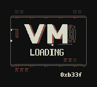
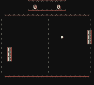

# ACE-ROM: VM Pong

ACE-ROM is a standalone Game Boy Color ROM built around a small native
bytecode runtime. On power-on, the runtime draws the `VM LOADING` screen and
the `0xb33f` signature one column at a time. It then installs a 499-byte Pong
cartridge from ROM and runs it in the VM.




The left paddle is controlled with **Up** and **Down**. Press **A** to serve.
The right paddle follows the ball, and scores wrap after 9.

## Build

Install Python 3.10 or newer, Make, and
[RGBDS 1.0.1](https://github.com/gbdev/rgbds/releases/tag/v1.0.1). The build
expects `rgbasm`, `rgblink`, and `rgbfix` on `PATH`.

```sh
make
```

This creates `build/vm-pong-demo.gb`, a 32 KiB CGB-only cartridge. The same
ROM is kept in `release/vm-pong-demo.gb` for direct use. Its SHA-256 is:

```text
ddecb5ed7927fb6eb07cea62a34e0a8207989ddb7f0cf00bf71c1c8a29da353d
```

Open the ROM in a Game Boy Color emulator. Pong appears about seven seconds
after reset. To repeat the pinned headless check, install the validation
dependency and run:

```sh
python3 -m pip install -r requirements-validation.txt
make validate
```

The build itself has no Python package dependencies. `make clean` removes its
generated files. [design-doc.md](design-doc.md) describes the runtime, VM,
cartridge format, and memory layout. [VALIDATION.md](VALIDATION.md) records the
tested toolchain and emulator checkpoints.

The source and artwork are available under the [MIT License](LICENSE.md).
[PROVENANCE.md](PROVENANCE.md) records the origin of the project assets and
third-party components.
